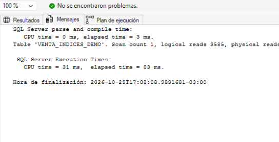
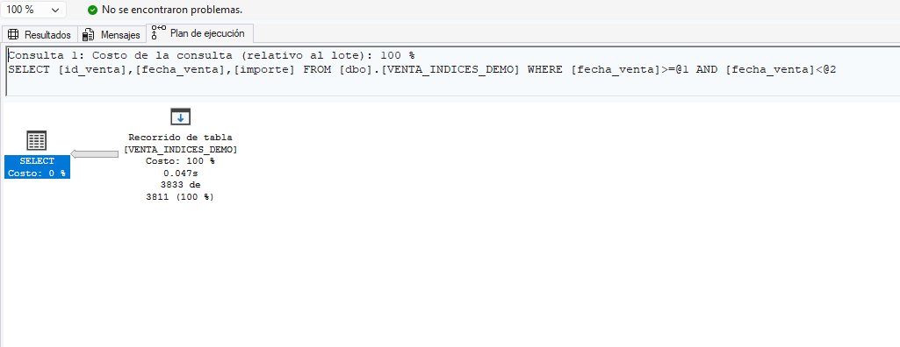
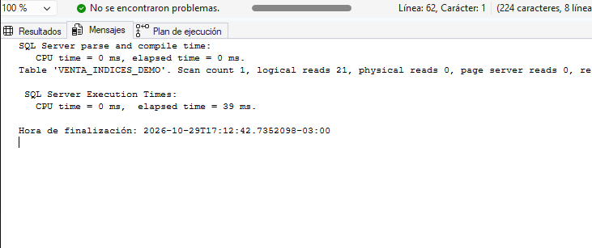
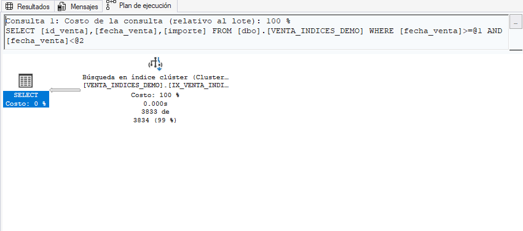
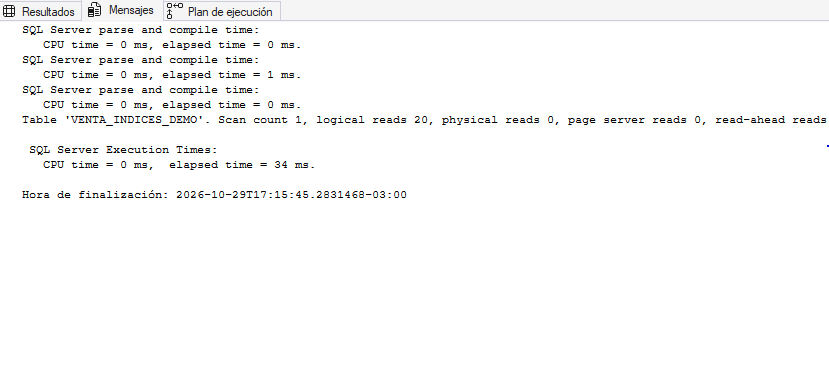
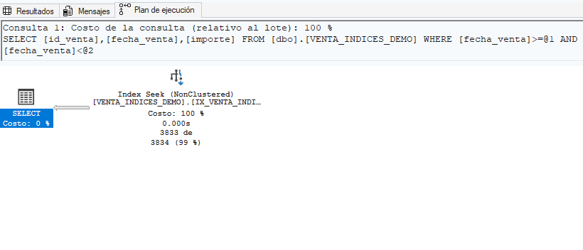

# Optimización de consultas a través de índices — NexusMobile

**Etapa V — SQL Server 2025 Express / SSMS 22**  
**Script:** [`sql/tecnico/indices/indices.sql`](../../sql/tecnico/indices.sql)  

## 1. Definición y objetivo

Un **índice** es una estructura de acceso que permite a SQL Server encontrar filas sin necesariamente recorrer toda la tabla. El optimizador decide si conviene utilizarlo según el filtro, la selectividad y las estadísticas disponibles.

- **Índice agrupado (clustered):** organiza las filas de la tabla según la clave del índice. Solo puede existir uno por tabla. Una búsqueda por rango de fechas puede beneficiarse de un `Clustered Index Seek`.
- **Índice no agrupado (nonclustered):** estructura separada que contiene claves de búsqueda y localizadores de fila. Puede haber varios por tabla.
- **Índice con cobertura (covering):** contiene todas las columnas que una consulta necesita; evita consultar la tabla base para recuperar columnas faltantes. En SQL Server, `INCLUDE` se utiliza en índices **no agrupados**, no en índices agrupados.

**Objetivos de aprendizaje:** conocer tipos de índices y aplicaciones; medir el impacto de indexar fechas en tiempos de CPU, duración y lecturas lógicas; interpretar planes de ejecución reales.

## 2. Ventajas y aplicaciones

Los índices pueden reducir lecturas lógicas y tiempos de respuesta en filtros por fechas, clientes, productos y rangos. En NexusMobile, esto es útil para reportes de ventas por período. Un índice de cobertura también puede resolver una consulta sin acceder a la tabla original.

**Costos y limitaciones:** ocupan espacio, aumentan el trabajo de mantenimiento de `INSERT`, `UPDATE` y `DELETE`, y no garantizan un `Seek` en todos los casos. Para rangos amplios, un escaneo puede resultar más económico. Un índice agrupado incluye los datos de la fila, por lo que un índice no agrupado de cobertura no necesariamente será más rápido.

## 3. Implementación en SQL Server Express

El archivo `indices.sql` contiene una demostración reproducible, dividida en bloques que se ejecutan en orden:

1. Crear `dbo.VENTA_INDICES_DEMO` **sin clave primaria ni índice**, de modo que inicialmente sea una tabla *heap*.
2. Generar automáticamente **1.000.000 de registros ficticios**, con `id_venta`, `fecha_venta` e `importe`.
3. Consultar un período **sin índice**, registrar estadísticas y plan.
4. Crear un índice **agrupado** sobre `fecha_venta` y repetir exactamente el mismo `SELECT`.
5. Eliminar el índice agrupado.
6. Crear un índice **no agrupado con cobertura** sobre `fecha_venta INCLUDE (id_venta, importe)` y repetir el mismo `SELECT`.
7. Comparar métricas y documentar conclusiones.

### Procedimiento de medición en SSMS

1. Abrir `indices.sql` conectado a `NexusMobile`.
2. Ejecutar los bloques 1 y 2; verificar que `Registros = 1000000`.
3. Antes del bloque 3, activar **Consulta → Incluir plan de ejecución real** (`Ctrl+M`).
4. Ejecutar el bloque 3. En **Mensajes**, copiar `SQL Server Execution Times` (**CPU time** y **elapsed time**) y `Table 'VENTA_INDICES_DEMO'` (**logical reads**). Guardar una captura del plan real (pestaña **Plan de ejecución**).
5. Ejecutar el bloque 4 y luego el bloque 5. Registrar las mismas métricas y guardar el segundo plan.
6. Ejecutar los bloques 6 y 7, y luego el bloque 8. Registrar las mismas métricas y guardar el tercer plan.
7. Repetir cada escenario varias veces en condiciones similares si se desea comparar medianas. No incluir los tiempos de **creación de índices** en el tiempo de la consulta.

**Consulta idéntica en los tres escenarios:**

```sql
SELECT id_venta, fecha_venta, importe
FROM dbo.VENTA_INDICES_DEMO
WHERE fecha_venta >= '20230501'
  AND fecha_venta < '20230508';
```

Se usa un rango semiabierto (`>=` y `<`) para definir claramente el período. En esta tabla, `fecha_venta` es `DATE`; este patrón también resulta apropiado si en el futuro se usa `DATETIME`.

## 4. Caso concreto aplicado al sistema de ventas del equipo

**Problema:** NexusMobile necesita consultar ventas realizadas en un período, por ejemplo del **1 al 7 de mayo de 2023**, sin demoras al crecer el volumen de operaciones.

El sistema real dispone de `dbo.VENTA`, con `nro_venta`, `fecha_hora`, `canal_venta`, `metodo_pago` y `dni_cliente`, y de `dbo.CONTIENE`, con cantidades y precios unitarios. Sin embargo, la base utilizada en las pruebas de la Etapa 4 solo contenía **tres ventas (2001, 2002 y 2003)**: es una muestra demasiado pequeña para comparar índices de forma representativa.

Por eso se crea **`dbo.VENTA_INDICES_DEMO`**, una tabla de laboratorio independiente que representa el historial simplificado de ventas, conserva el concepto de fecha e importe y **no altera las ventas, clientes ni relaciones reales**. Esta decisión permite probar un millón de filas sin violar claves foráneas ni contaminar los informes de NexusMobile.

| Elemento | En NexusMobile | En la demostración |
|---|---|---|
| Identificador | `VENTA.nro_venta` | `id_venta` |
| Fecha | `VENTA.fecha_hora` | `fecha_venta` |
| Importe | Calculado desde `CONTIENE` | `importe` ficticio |
| Uso | Operaciones reales | Prueba aislada de rendimiento |

## 5. Script de demostración y resultados obtenidos

**Archivo entregado:** [`indices.sql`](../../sql/tecnico/indices/indices.sql). Incluye la creación, carga masiva, tres consultas medidas, creación y eliminación de índices y verificación final.

### Resultados obtenidos en SQL Server Management Studio 22

Se ejecutaron los tres escenarios sobre `dbo.VENTA_INDICES_DEMO`, con **1.000.000 de registros**, manteniendo exactamente la misma consulta y el mismo rango: **1 al 7 de mayo de 2023** (`fecha_venta >= '20230501' AND fecha_venta < '20230508'`). Las capturas de **Mensajes** y **Plan de ejecución real** de SSMS constituyen la evidencia de las mediciones.

| Escenario | CPU (ms) | Duración (ms) | Lecturas lógicas | Filas devueltas | Operación principal del plan real |
|---|---:|---:|---:|---:|---|
| A. Tabla sin índice (*heap*) | 31 | 83 | 3.585 | 3.833 | `Table Scan` |
| B. Índice agrupado sobre fecha | 0 | 39 | 21 | 3.833 | `Clustered Index Seek` |
| C. Índice no agrupado con cobertura | 0 | 34 | 20 | 3.833 | `Index Seek (NonClustered)` |

> **Interpretación del CPU:** los valores de `0 ms` de los escenarios B y C corresponden a la precisión con la que SQL Server informó esa ejecución; no significan consumo nulo de CPU. Los tiempos registrados son de una ejecución por escenario, no promedios ni medianas.

### Documentación de los planes de ejecución reales

**Escenario A — sin índice.** El plan muestra un **`Table Scan`** (*Recorrido de tabla*) sobre `VENTA_INDICES_DEMO`, con un costo relativo del operador del **100 %** dentro de ese plan. La consulta devuelve **3.833 filas**, pero el motor necesita recorrer la estructura de la tabla para aplicar el filtro por fecha. Se registraron **3.585 lecturas lógicas**, **31 ms de CPU** y **83 ms de duración**. Evidencia: capturas del Escenario A, pestañas **Mensajes** y **Plan de ejecución**.

**Escenario B — índice agrupado por fecha.** Tras crear `IX_VENTA_INDICES_DEMO_Fecha`, el plan muestra **`Clustered Index Seek`** (*Búsqueda en índice clúster*), con costo relativo del operador del **100 %** dentro de su propio plan. Se recuperan las mismas **3.833 filas** mediante búsqueda por rango de fecha. Se registraron **21 lecturas lógicas**, **0 ms de CPU informado** y **39 ms de duración**. Evidencia: capturas del Escenario B, pestañas **Mensajes** y **Plan de ejecución**.

**Escenario C — índice no agrupado con cobertura.** Después de eliminar el índice agrupado y crear `IX_VENTA_INDICES_DEMO_Fecha_Cobertura` sobre `fecha_venta INCLUDE (id_venta, importe)`, el plan muestra **`Index Seek (NonClustered)`**. No aparece un operador adicional `RID Lookup` en el plan mostrado: el índice contiene todas las columnas necesarias para resolver el `SELECT`. Se obtuvieron **3.833 filas**, **20 lecturas lógicas**, **0 ms de CPU informado** y **34 ms de duración**. Evidencia: capturas del Escenario C, pestañas **Mensajes** y **Plan de ejecución**.

**Sobre los porcentajes de costo:** el **100 %** mostrado para el operador principal se refiere al costo estimado relativo *dentro de cada plan*, no al uso del procesador ni a una comparación directa de rendimiento entre los tres escenarios. Las capturas muestran aproximadamente **3.834 filas estimadas** frente a **3.833 filas reales** en los escenarios indexados.

### Evaluación cuantitativa de la mejora

La reducción porcentual se calculó respecto del Escenario A:

```text
Reducción (%) = (Valor_A - Valor_escenario) / Valor_A × 100
```

| Comparación | Reducción de duración | Reducción de lecturas lógicas |
|---|---:|---:|
| B respecto de A | 53,01 % | 99,41 % |
| C respecto de A | 59,04 % | 99,44 % |
| C respecto de B | 12,82 % | 4,76 % |

El índice agrupado redujo las lecturas de **3.585 a 21**, mientras que el índice de cobertura las redujo a **20**. La reducción de lecturas es mucho mayor que la reducción de duración porque el tiempo transcurrido también depende de otros factores, como caché, planificación, envío de resultados y carga del equipo.

### Conclusiones de las pruebas

1. **Sin índice:** SQL Server utilizó `Table Scan`, con **3.585 lecturas lógicas** y **83 ms** de duración. El motor tuvo que examinar la tabla para encontrar las ventas del período.
2. **Índice agrupado sobre fecha:** la operación cambió a `Clustered Index Seek`. Las lecturas disminuyeron **99,41 %** y el tiempo registrado **53,01 %** frente a la consulta sin índice.
3. **Índice no agrupado con cobertura:** el plan utilizó `Index Seek (NonClustered)` sin búsquedas adicionales a la tabla. Registró **20 lecturas lógicas** y **34 ms**, los mejores valores de esta ejecución: **99,44 % menos lecturas** y **59,04 % menos tiempo** que el Escenario A.
4. **Comparación entre índices:** la diferencia entre B y C fue pequeña (**una lectura lógica y 5 ms**). Una sola ejecución no permite asegurar que el índice de cobertura sea siempre más rápido; sería conveniente repetir cada prueba varias veces y comparar medianas.
5. **Aplicación a NexusMobile:** los resultados muestran el beneficio potencial de indexar fechas en reportes de ventas por período. Sin embargo, antes de incorporar un índice a la tabla operativa `dbo.VENTA`, deben analizarse sus índices existentes, las consultas habituales y el costo de mantenimiento en inserciones, actualizaciones y eliminaciones.

### Evidencias


### Escenario A: Sin índice

**Estadísticas de ejecución:**



**Plan de ejecución — Table Scan:**



### Escenario B: Índice agrupado

**Estadísticas de ejecución:**



**Plan de ejecución — Clustered Index Seek:**



### Escenario C: Índice de cobertura

**Estadísticas de ejecución:**



**Plan de ejecución — NonClustered Index Seek:**


  